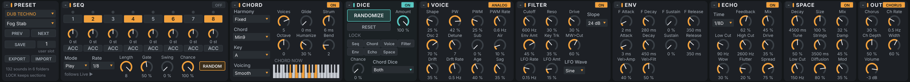
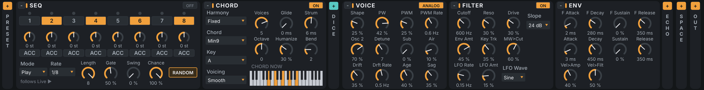

# NEBBIA — living chord engine

Strumento **Max for Live** per Ableton Live, nato per la **dub techno underground** (suoni scuri, profondi,
fatti di eco e di spazio) e con preset anche per **deep/minimal, ambient, intro morbide, drone e sperimentale**.
Una nota diventa un accordo, che puoi suonare dal piano roll, dalla tastiera o dal **sequencer interno** a 8 step.
L'accordo nasce da un generatore che fa voice leading e può tirare il dado. Passa per 6 voci analogiche che si
comportano come un circuito vero, poi per un tape echo dub e infine per uno spazio le cui **corde simpatiche si
riaccordano sull'accordo** che stai suonando.



*Anteprima del pannello generata dal file della patch. In Live le manopole hanno lo stile nativo.*

Tutto è digitale (gen~, compilato in C dentro Max). Non usa campioni né wavetable.

---

## Provarlo senza Live (anche su iPad)

`web/` contiene **Nebbia Player**: una pagina che suona nel browser lo stesso motore audio del device (generato
da `src/build.py` in `web/engine.js`, identico campione per campione alla copia usata nei test), con i 132 preset,
i pad, il sequencer, Randomize e i controlli principali. Serve per ascoltare e scegliere i suoni; il device
completo gira in Ableton Live.

---

## Installazione

Serve **Ableton Live 11 o 12 Suite**, oppure Standard con l'add-on Max for Live. gen~ è già incluso.

1. Scarica `Nebbia.amxd`.
2. Trascinalo su una traccia MIDI di Live.
3. Suona una nota: senti già un accordo dub.

Per tenerlo nel browser di Live, copia il file in
`User Library/Presets/Instruments/Max Instrument/`.

> Al primo caricamento Max compila il codice gen~: può servire un secondo.
> **Se il device resta muto o non si carica**, clicca *Edit* e apri *Window → Max Console*.
> Se c'è un errore in rosso, copialo e mandamelo.
>
> **Piano B se Live non accetta il file `.amxd`:** trascina un *Max Instrument* vuoto
> (Browser → Max for Live), clicca *Edit*, apri `Nebbia.maxpat` in Max, seleziona tutto, copia,
> incolla nella patch del device vuoto e salva.

**Passa col mouse su qualsiasi controllo:** la *Info View* di Live (in basso a sinistra, tasto `?`) ti spiega
in italiano cosa fa.

---

## Preset

La colonna **PRESET** a sinistra è organizzata **per cartelle, per genere e stile**:

1. **Cartella** (menu arancione): scegli il genere.
2. **Preset** (menu sotto): scegli il suono, si carica subito.
3. **◀ / ▶**: carica il preset precedente o successivo della cartella (ricomincia dall'inizio in fondo alla lista).

| Cartella | Preset | Nomi |
|---|---|---|
| **DUB TECHNO** | 22 | Fog Stab, Concrete Dub, Echo Throw, Submerged, Tape Ghost, Strings In Fog, Basement Chord, Rain On Steel, Underground Wave, Industrial Harbour, Iron Drop, Wet Bunker, Hollow Vapour, Smoked Pulse, Rusted Tower, Damp Pressure, Echoing Stab, Faded Siren, Midnight Signal, Tunnel Dub, Muted Rail, Foggy Delay |
| **DEEP / MINIMAL** | 22 | Deep Minimal Stab, Velvet Chord, Late Night Keys, Pulse Chord, Smoke Organ, Shuffle Stab, Inner Room, Hazy Signal, Liquid Pulse, Dusky Hours, Blue Tones, Small Keys, Muted Club, Subtle Steps, Smoky Chord, Dark Touch, Sunken Lounge, Quiet Stab, Late Motion, Deep Swing, Night Tide, Velvet Loop |
| **AMBIENT** | 22 | Soft Horizon, Breathing Pad, Glass Haze, Slow Tide, Warm Blanket, Cloud Choir, Distant Lights, Weightless Dawn, Quiet Shore, Evening Garden, Open Memory, Faded Waves, Floating Tide, Vast Mist, Pale Sky, Drifting Rain, Hidden Breath, Still Air, Silent Haze, Morning Clouds, Soft Lake, Glass Light |
| **INTRO / SOFT** | 22 | First Light, Soft Pulse Intro, Morning Fog, Tape Lullaby, Gentle Swell, Low Hum Intro, Tender Arrival, Opening Room, Faint Glow, Hushed Thread, Rising Ember, Early Swell, Small Murmur, Waking Path, Quiet Light, Shy Breath, Silver Signal, Patient Pulse, Calm Promise, Slow Door, Gentle Hum, Low Steps |
| **DRONE** | 22 | Night Drone, Deep Ocean, Cathedral Low, Static Field, Endless Fifths, Sunken Tone, Iron Engine, Infinite Tide, Grey Depth, Black Void, Heavy Haze, Frozen Bed, Dark Current, Vast Organ, Ancient Monolith, Cold Floor, Buried Drone, Low Pressure, Ocean Horizon, Endless Choir, Cathedral Hall, Deep Hum |
| **EXPERIMENTAL** | 22 | Broken Machine, Metal Strings, Runaway Echo, Random Colors, Self Oscillate, Glitch Strum, Phase Haunt, Unstable Noise, Melted Spiral, Strange Colors, Bent Bloom, Haunted Organism, Corrupt Echo, Mutant Voltage, Glitched Radio, Erratic Glass, Wild Code, Feral Swarm, Shattered Ghost, Fractured Engine, Twisted Logic, Sick Metal |
| **USER** | 8 | User 1–8: i tuoi |

In tutto sono **132 preset di fabbrica, 22 per cartella**. Ogni preset ha anche il suo pattern per il sequencer ed è
**livellato in volume**: passando da uno all'altro non hai salti di livello.

I primi di ogni cartella sono fatti a mano. Gli altri li ha generati `test/gen_presets.py` nello stile della
cartella (caratteri, accordi, pattern e progressioni di quel genere): ogni candidato è stato suonato offline e
tenuto solo se passava i controlli (nessun errore, volume giusto, abbastanza scuro dove la cartella è scura).

- **SAVE**: salva il suono attuale nello slot User scelto nel numerino accanto (1–8) e apre la cartella USER.
  I preset User restano salvati **dentro il progetto di Live**.
- **EXPORT / IMPORT**: salva i tuoi preset User su un file e caricali in un altro progetto.
- I preset non cambiano mai **Key** e l'accensione del SEQ: quelli sono del tuo pezzo.
- I **lucchetti** proteggono le sezioni anche dai preset di fabbrica. Esempio: blocca SEQ e cambi suono senza
  perdere la tua sequenza.
- Anche **RANDOMIZE segue la cartella**: scuro in Dub Techno e Deep/Minimal, morbido in Ambient e Intro,
  lento in Drone, folle in Experimental.

Puoi usare anche il salvataggio di Live (icona del dischetto nel titolo del device): salva tutto come preset
di Live nella tua User Library.

---

## Comprimere le sezioni

Ogni sezione ha un pulsante **–** in alto a sinistra. Se non la usi, cliccalo: la sezione si chiude in una
striscia sottile con il nome in verticale, le sezioni a destra scivolano a sinistra e **il device si stringe**.
Il **+** sulla striscia la riapre. Il suono non cambia: comprimere è solo una questione di spazio.

Lo stato aperto o chiuso di ogni sezione si salva con il progetto.



---

## Da dove arrivano le note

Ogni nota che arriva a NEBBIA è la **fondamentale di un accordo**. Hai tre modi per dargliele:

| Come | Imposta | Cosa succede |
|---|---|---|
| **Piano roll / tastiera** | SEQ spento (OFF) | Scrivi *una* nota per accordo nel piano roll (o suonala). NEBBIA costruisce l'accordo. |
| **Sequencer interno** | SEQ acceso, Mode **Play** | Premi Play in Live: gli step suonano a tempo. Il MIDI di Live suona comunque sopra. |
| **Sequencer trasposto** | SEQ acceso, Mode **Trans** | Il pattern suona solo mentre tieni un tasto e parte da quel tasto. Perfetto dal vivo. |

> **"Voices" non serve a scrivere note.** È *quante* note ha l'accordo (2–6).
> Le note vere arrivano dal SEQ o dal MIDI di Live.

---

## Accendere e spegnere le sezioni

Ogni sezione ha un interruttore nell'intestazione. Quando è spenta, le sue manopole diventano grigie.

| Interruttore | Spento significa |
|---|---|
| SEQ | Il sequencer è fermo: suona solo il MIDI di Live |
| CHORD | Niente accordi: ogni nota suona da sola (bassi, lead). Restano Octave, Glide, Humanize e Bend |
| DICE | Il dado sugli accordi è fermo (Randomize, Reset e i lucchetti funzionano comunque) |
| VOICE · ANALOG | Niente Drift, Age e Sag: suono digitale pulito, identico su ogni voce |
| FILTER | Filtro escluso, passa l'oscillatore pieno |
| ECHO | Eco spento (la coda si chiude subito) |
| SPACE | Spazio e corde simpatiche spenti |
| SPACE · REV | Solo il riverbero interno spento: le corde simpatiche continuano. Per usare il tuo riverbero dopo NEBBIA. Preset e Reset non lo toccano |
| OUT · CHORUS | Chorus ensemble spento |

---

## Le sezioni

### SEQ — step sequencer a 8 step
Come un sequencer hardware: **una colonna per step**, da sinistra a destra.

| Riga | Cosa fa |
|---|---|
| LED | Lo step che sta suonando |
| **1 … 8** | Accende lo step. **Massimo 4 accesi**: il quinto si rispegne da solo |
| Manopola | La nota dello step, **±1 semitono per scatto** rispetto alla **Key** (0 = A2 se Key è A, +7 = una quinta sopra). In modalità Trans parte dal tasto che tieni premuto |
| **ACC** | Accento: lo step suona più forte |

Sotto, una sola riga di controlli:
- **Mode**: Play (suona quando premi Play in Live) o Trans (suona mentre tieni un tasto).
- **Rate**: durata di uno step, da 1/16 a 2 battute.
  - **1/8 con 2-4-6-8 accesi** = stab in levare su una battuta, il classico dub (è il default).
  - **1 Bar, Length 4, 1-2-3-4 accesi** = progressione di 4 accordi, uno per battuta.
- **Length** (quanti step usa), **Gate** (lunghezza della nota), **Swing** (ritarda gli step pari) e
  **Chance** (probabilità che uno step suoni: sotto 100% il pattern respira da solo).
- **RANDOM**: nuovo pattern (step accesi, note nella tua Key, accenti, Rate, Gate, Swing). Il suono non cambia.
- Segue il transport di Live con precisione al campione: niente jitter, sempre allineato alla battuta.

### CHORD — generatore di accordi con voice leading
- **Harmony = Fixed**: la nota suona il tipo scelto in *Chord*, trasposto in parallelo come negli
  stab Basic Channel.
- **Harmony = una scala** (Minor, Dorian, Phrygian, Major, Mixolydian, Lydian, Harmonic Minor) con la sua
  **Key**: la nota suona l'accordo *diatonico* di quel grado. Le note fuori scala vanno sul grado più vicino.
- **Voicing = Smooth / Smooth Op**: sceglie il rivolto con il movimento minimo rispetto all'accordo precedente,
  evita i cluster di semitono e resta nel registro della nota suonata.
  Esempio: Am9 → Fm9 diventa Fm9/Ab, senza salti.
- **Voices** (2–6 note), **Octave**, **Strum** (+ dal basso, − dall'alto), **Glide**, **Humanize**, **Bend**.
- **CHORD NOW**: la tastierina mostra in tempo reale le note che NEBBIA sta suonando.

### DICE — caso controllato
- **RANDOMIZE**: sceglie prima un **carattere** a caso tra quelli della cartella preset in cui sei (il nome
  appare nella sezione), poi genera una patch nuova coerente con quel carattere.

  | Cartella | Caratteri |
  |---|---|
  | Dub Techno, Deep / Minimal | DUB STAB, CONCRETE, DEEP CHORD, SUBMERGED, TAPE GHOST, THROW |
  | Ambient | SOFT PAD, SWELL, HAZE, FOG STRINGS |
  | Intro / Soft | SOFT PAD, SWELL, HAZE |
  | Drone | HAZE, FOG STRINGS, NIGHT DRONE |
  | Experimental | BROKEN, METAL, RUNAWAY |
  | User | tutti |
  - Accordi casuali sempre scuri (minori, sus, quartali, m7/m9/m11, So What), scale solo Minor, Dorian,
    Phrygian e Harmonic Minor.
  - Il cambio è radicale: inviluppi, filtro, oscillatori, eco, spazio, analog e accordo cambiano insieme.
  - Può accendere o spegnere eco, spazio, chorus e analog quando ha senso per quel carattere.
  - **Amount** decide quanto: basso = variazione della patch attuale, 100% = patch nuova.
  - Randomizza anche il pattern del SEQ.
  - Le manopole si muovono davvero, quindi puoi annullare con Cmd/Ctrl+Z.
- **RESET**: riporta tutto ai valori iniziali. La Key resta quella del tuo pezzo.
- **LOCK** (Seq, Chord, Voice, Filter, Env, Echo, Space): le sezioni accese restano come sono, sia con
  Randomize sia con Reset. Esempio: blocca Filter ed Echo, poi premi Reset per azzerare solo il resto.
- **Chance + Chord Dice**: a ogni nota, con la probabilità *Chance*, l'accordo tira il dado.
  - **Color**: un altro accordo della stessa famiglia (minore resta minore).
  - **Voicing**: rivolto e ottava diversi.
  - **Both**: entrambi.
  - **Wild**: qualsiasi accordo.

  Ottieni progressioni che cambiano da sole senza toccare la clip.

### VOICE / FILTER / ENV — sei voci analogiche "vive"
- Oscillatori **PolyBLEP** anti-aliasing: dente di sega e pulse con PWM, secondo oscillatore detunato,
  sub sulla nota più bassa e rumore (*Air*).
- **Filtro ladder 4 poli ZDF** per ogni voce, con saturazione, a 24 o 12 dB. Stabile anche in auto-oscillazione.
- **Age**: ogni voce ha tolleranze di componente fisse (accordatura, cutoff, risonanza, inviluppi, livello).
- **Drift / Drift Rate**: deriva lenta casuale per voce più una deriva termica comune.
- **Sag**: con accordi pieni l'alimentazione "cede". Intonazione, filtro e livello calano insieme per tutte le
  voci e l'accordo respira.
- LFO sul cutoff (Sine, Triangle, S&H, Drift), mod wheel sul cutoff e due ADSR con curve RC.

### ECHO / SPACE / OUT
- **Echo**: tape delay a tempo con Live. Nel loop ci sono filtri passa-alto e passa-basso, saturazione,
  wow, flutter e ping-pong. Il feedback arriva al 110% per le fughe dub.
- **Space**: riverbero FDN a 8 linee più 6 **corde simpatiche** accordate in tempo reale sull'accordo, che
  seguono anche il glide. **Tune** fa il morph tra riverbero normale e corpo risonante.
  Misurato: con Tune 100% l'**89%** dell'energia della coda sta sulle note dell'accordo (79% senza).
- **Out**: chorus a ensemble stereo (3 linee per lato, sfasate), larghezza mid/side, volume e un **limiter
  look-ahead pulito a −1,5 dBFS**. Il limiter interviene solo sui colpi più forti (i preset sono tarati
  perché tolga al massimo 1,5 dB), così l'uscita non clippa e non si schiaccia.

### Gain staging: perché suona aperto e non clippa
- Il livello che entra nel filtro è normalizzato su quanti oscillatori stanno suonando (Osc 2, Sub),
  quindi accordi pieni e oscillatori in più non saturano il filtro da soli. Lo spinge solo **Drive**.
- Dopo il filtro il guadagno viene compensato: più Drive significa più carattere, non più volume.
- Le voci sono aperte nello stereo (dalla più bassa, quasi al centro, alla più alta, ai lati). Il chorus
  ensemble e il mid/side allargano il suono senza annullarsi in mono.
- Misurato sui preset principali:

  | | Prima | Ora |
  |---|---|---|
  | Campioni nel soft clip | 8–27% | **0%** |
  | Correlazione L/R in uscita (1 = mono) | 0,44–0,73 | 0,13–0,56 |
  | Energia sopra 3 kHz sugli stab | 0,2–0,8% | 1,5–3,3% |

---

## Tutti i parametri

105 controlli del suono e del sequencer, tutti automatizzabili, mappabili su MIDI/Push e modulabili.

| Sezione | Parametri |
|---|---|
| SEQ | On, Mode (Play/Trans), Rate, Length, Gate, Swing, Chance, Random, Step 1–8: On / Note / Accent |
| CHORD | On, Harmony, Chord, Key, Voicing, Voices, Octave, Strum, Glide, Humanize, Bend |
| DICE | On, Randomize, Reset, Amount, Lock ×7, Chance, Chord Dice |
| VOICE | Analog, Shape, PW, PWM, PWM Rate, Osc 2, Detune, Sub, Air, Drift, Drift Rate, Age, Sag |
| FILTER | On, Cutoff, Reso, Drive, Slope, Env Amt, Key Trk, MW>Cut, LFO Rate, LFO Amt, LFO Wave |
| ENV | F Attack/Decay/Sustain/Release, Attack/Decay/Sustain/Release, Vel>Amp, Vel>Filt |
| ECHO | On, Time, Feedback, Mix, Low Cut, High Cut, Drive, Wow, Flutter, Spread |
| SPACE | On, Rev, Decay, Size, Mix, Tune, Strings, Damp, Low Cut, Diffusion, Mod |
| OUT | Chorus on, Chorus, Ch Rate, Ch Depth, Width, Volume |

Chord disponibili: Min7, Min9, Min11, m7 Open, m11 Open, So What, Quartal, Sus2, 7sus4, Minor, Major,
Maj7, Maj9, Dom9, m7b5, Fifths.

---

## Ricette veloci

- **Stab classico (default)**: cartella Dub Techno, *Fog Stab*, accendi SEQ, premi Play in Live.
  Automatizza Cutoff ed Echo Feedback.
- **Intro morbida**: cartella Intro / Soft, *First Light*, poi apri piano piano il Cutoff.
- **Fuga dub**: Echo Feedback oltre 100% per qualche battuta, High Cut basso, Wow alto.
- **Progressione che si scrive da sola**: Harmony Dorian, SEQ Rate *1 Bar*, Length 4, step 1-2-3-4 accesi,
  DICE Chance 30% su *Color*.
- **Organo nella nebbia**: Voices 4, Attack 500 ms, Sustain 70%, Glide 200 ms, Strum 40 ms, Tune 80%, Strings 8 s.
- **Macchina vecchia**: Age 80%, Drift 60%, Sag 70%, Air 25%.
- **Digitale pulito**: Age 0, Drift 0, Sag 0, Humanize 0.

## Demo

In `demo/` ci sono i render offline dello stesso DSP:

| File | Cosa senti |
|---|---|
| `prima_dopo.mp3` | Sei preset suonati due volte, prima col motore vecchio e poi con quello nuovo, allo stesso volume |
| `dub_stabs.mp3` | Il suono di default, stab in levare |
| `presets_dub_techno.mp3`, `presets_deep_minimal.mp3`, `presets_ambient.mp3`, `presets_intro_soft.mp3`, `presets_drone.mp3`, `presets_experimental.mp3` | Una cartella per file: i primi 3 secondi di ogni preset, col suo pattern |
| `randomize_tour.mp3` | Una pressione di RANDOMIZE per ognuno dei 14 caratteri |
| `seq_progression.mp3` | Il sequencer interno: D Dorian, un accordo per battuta |
| `dice_stabs.mp3` | Lo stesso stab con il dado al 100%: ogni colpo cambia colore e rivolto |
| `dorian_pads.mp3` | Modalità scala, glide e strum su un pad |
| `space_tune0.mp3` / `space_tune100.mp3` | Lo stesso stab con riverbero normale e con le corde accordate |

`demo/dub_stabs.mid` è una clip di 4 battute da trascinare su una traccia con NEBBIA.

---

## Modificarlo

Tutto è generato da un solo file, `src/build.py`: accordi, scale, parametri, layout, colori, testi
d'aiuto e DSP.

```bash
python3 src/build.py           # rigenera Nebbia.amxd, Nebbia.maxpat, src/nebbia.genexpr
node test/render.js            # rende i test in demo/*.wav (gemello JavaScript del DSP)
python3 test/analyse_space.py  # misura quanto lo spazio "canta" l'accordo
python3 test/preview_ui.py ui.html  # anteprima del pannello
```

Il test `torture` porta tutti i parametri al massimo e verifica che l'uscita resti finita e limitata.
`seq_play`, `seq_bars`, `seq_pos`, `seq_trans`, `dice`, `all_off` ed `echo_kill` verificano sequencer, dado e
interruttori. `python3 test/random_tour.py` rende un giro di Randomize. `python3 test/presets_tour.py` rende i
preset di fabbrica con centroide spettrale e loudness; con `--calibrate` riscrive `src/preset_levels.json` per
livellarli. `python3 test/gen_presets.py` rigenera i preset generati, `python3 test/validate_patch.py` controlla
la patch (collegamenti, parametri, send/receive delle sezioni). `python3 test/test_logic.py` simula la logica
della patch (`test/maxsim.py`) e clicca preset, frecce, lucchetti, Reset, Randomize, RANDOM, SAVE e compressione,
controllando cosa arriva al motore audio.
